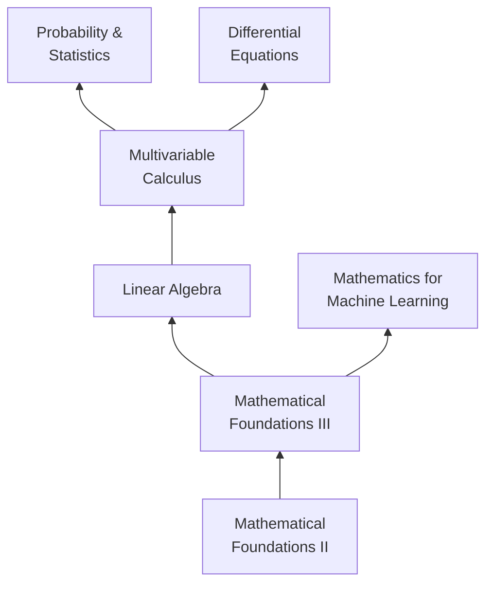
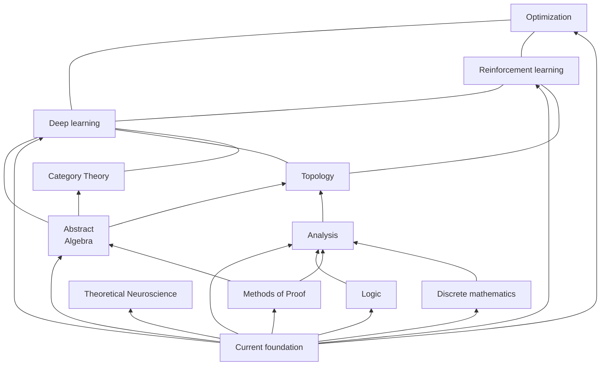

---
aliases:
  - /posts/self-studying-mathematics/
title: Self-studying mathematics
tags:
  - math
toc: true
math: true
date: 2025-04-25
---

I'm starting this blog as a way to document progress on a long-standing goal of mine — teaching myself mathematics.

In 2021, in the midst of COVID, I had the realization I would end up working either on psychopharmacology or theoretical neuroscience in my career. So I did a master's in cognitive neuroscience and psychopharmacology (it was not the right fit), but I was fortunate enough to do some research that gradually led me toward the ideas I'm thinking about now. So it's time to learn math. I've decided to build this website and document my journey as a way of motivating myself and building a portfolio along the way. There are many brilliant mathematicians and engineers out there, and if I hope to compete, I will need to show my work. In a few months, I'll attend the [Gatsby Bridging Programme](https://www.ucl.ac.uk/gatsby/study-and-work/gatsby-bridging-programme), but until then I'm going to speed-run as much math as I can stomach.

I've cobbled together a learning plan based on MIT's excellent [OpenCourseWare](https://ocw.mit.edu/), some textbooks I've been recommended, and the Open Source Society University's [math course](https://github.com/ossu/math). I've been following the team at [Math Academy](https://www.mathacademy.com/) for a while now and have decided to make MA my primary form of learning, using textbooks and courses as supplementary (especially while traveling or when I'm without access to a laptop + iPad to study from). Their team has clearly thought through their [method](https://www.mathacademy.com/pedagogy) and it's worked well for me so far. I'm not sure why there isn't more competition for this kind of approach. Reversing [the decline of genius](https://www.theintrinsicperspective.com/p/why-we-stopped-making-einsteins) is one of the most exciting use-cases for AI (and specifically chatbots). Their approach is based on feedback, using AI to solve the [two sigma problem](https://www.jstor.org/stable/1175554) — that is, students tutored one-on-one perform, on average, two standard deviations (98% in a normal distribution!) better than students learning via conventional methods. The problem being that one-on-one tutoring is *incredibly expensive*.

Of course, one has to believe that the feedback that chatbots can provide is *effective* in principle or in practice (see a [counterargument](https://joshbrake.substack.com/p/ai-tutors-cant-solve-blooms-two-sigma-problem)). I'm not convinced by the idea that *most* teachers outperform chatbots in identifying the source of human error and the emotion involved right now, let alone in a few years. From my own educational experience, it's clearly not the case — the learning I do with LLMs is significantly more effective. 

In the two months I have until the Gatsby programme, I'll be trying to speed-run the following:

The thing about learning a new subject is that you often don't know what you don't know. Mentors provide wonderful roads to follow, but as I progress, I'll inevitably start to focus on one area or another. The above diagram will likely not change much, if at all. When writing this post, a friend told me, "the mission should be to learn enough math to ditch this diagram ASAP and come up with a better one." I share the below diagram as proof of my innocence:

This one is... a bit more of a mess. At this point, there are aspects of these fields I feel surface-level interested in, but we'll see where the actual mathematics takes me.

I’ve wanted to do this for a long time. Publishing this plan is my way of making it real. If you're interested in doing something similar, you can subscribe to the [newsletter](https://bobbytromm.substack.com/subscribe) or follow the [RSS feed](https://btromm.github.io/writing/index.xml). I've been looking forward to this kind of focus, calm, and single-mindedness for a long time. I *might* end up going back to school to do a proper degree in math; maybe I'll get into a PhD program first. We'll see. Either way, this is for now.